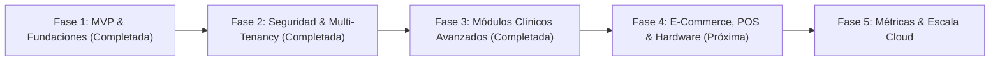

# Plan Integral de Desarrollo: Altus PetCloud SaaS
**Plataforma Integral de Gestión Veterinaria y Spa Canino**  
*Estándar Tecnológico & Branding: Altus MKT Digital*

---

## 1. Visión y Alcance del Proyecto
Llevar la plataforma **Altus PetCloud** desde su estado actual hasta una solución SaaS Enterprise multi-sucursal en la nube, optimizada para clínicas veterinarias, hospitales 24/7 y centros de estética/spa canino.

---

## 2. Estado de Fases y Cronograma de Sprints

### Fase 1: Fundaciones y MVP Base (Estado: COMPLETADA ✅)
- [x] **Base de Datos Relacional:** PostgreSQL en la nube con llaves foráneas e índices de alto rendimiento (`database/schema.sql`).
- [x] **Backend API REST:** Node.js/Express con transacciones ACID para cobro y descuento de stock atómico.
- [x] **Punto de Venta (POS):** Escáner nativo de códigos de barras (HID) e impresión térmica continua (80mm/58mm) vía `window.print()` y CSS `@media print`.
- [x] **Módulo de Citas:** Gestión de estados (Programada, En Curso, Completada, Cancelada) y asignación por profesional.
- [x] **Versionado:** Repositorio en GitHub configurado en rama `main`.

---

### Fase 2: Autenticación, Roles y Multi-Tenancy (Estado: COMPLETADA ✅)
**Objetivo:** Seguridad perimetral, RBAC por perfiles y particionado lógico multi-sucursal.

#### Sprint 1: Autenticación Robusta y RBAC ✅
- [x] Implementación de JWT (JSON Web Tokens) con cifrado y validación de expiración.
- [x] Hashing criptográfico de contraseñas con `bcryptjs` (12 rounds de salt).
- [x] Middlewares `auth.middleware.js` para validación de Bearer Token y control de roles (`requireRoles`).
- [x] Endpoints de autenticación (`/api/auth/register`, `/api/auth/login`, `/api/auth/profile`).
- [x] Protección de rutas: Altas de productos exclusivas de `ADMIN`, creación de historias clínicas para `VETERINARIAN`, y POS para `ADMIN` y `RECEPTIONIST`.
- [x] Estado global de sesión en React mediante `AuthContext.jsx` y modal interactivo `LoginModal.jsx`.

#### Sprint 2: Arquitectura Multi-Clínica y Sucursales ✅
- [x] Migración SQL `002_multi_tenant.sql` con tablas `tenants` y `branches`.
- [x] Enlace de llaves foráneas `tenant_id` y `branch_id` en todas las tablas de negocio con índices de particionado lógico.
- [x] Extracción automática de `req.tenantId` y `req.branchId` en middleware desde el token o encabezados HTTP (`x-tenant-id`, `x-branch-id`).
- [x] Módulo backend de sucursales en `branches.routes.js`.
- [x] Selector dinámico de sucursal en el Sidebar del Frontend con persistencia en LocalStorage.

---

### Fase 3: Expediente Clínico Digital y Kardex Hospitalario (Estado: COMPLETADA ✅)
**Objetivo:** Digitalizar al 100% el flujo de consulta, hospitalización y control de fármacos.

#### Sprint 3: Historia Clínica y Recetas Electrónicas ✅
- [x] Migración SQL `003_clinical_and_prescriptions.sql` con tablas `prescriptions`, `prescription_items` y `clinical_attachments`.
- [x] Backend API de recetas (`/api/prescriptions`) con asignación de folio único, diagnóstico y desglose de fármacos.
- [x] Plantilla y Modal oficial en Frontend `PrescriptionPDFModal.jsx` para visualización y descarga/impresión directa en PDF con membrete clínico, cédula profesional y código de validación.

#### Sprint 4: Kardex de Hospitalización en Tiempo Real ✅
- [x] Monitor clínico de internamiento con semáforo de criticidad dinámico (`STABLE` Verde, `OBSERVATION` Amarillo, `CRITICAL` Rojo) y asignación de jaula/box.
- [x] Endpoint seguro `/api/kardex/:id/administer` con registro de profesional responsable y descuento atómico de inventario médico al suministrar la dosis.
- [x] Componente integrado `ClinicalKardexView.jsx` con métricas de dosis pendientes, administradas y filtro de criticidad.

---

### Fase 4: Optimización del Hardware Web, POS e Inventario (Estado: PENDIENTE ⏳)
**Objetivo:** Máxima velocidad operativa en mostrador y farmacia veterinaria.

#### Sprint 5: POS Avanzado y Conexión de Periféricos
- [ ] Integración con básculas digitales mediante Web Serial API.
- [ ] Apertura de caja, arqueo de turnos y Corte Z diario con impresión de reporte térmico.
- [ ] Pasarela de cobros con terminal bancaria.

#### Sprint 6: Control de Inventario & Alertas Inteligentes
- [ ] Trazabilidad de lotes y fechas de caducidad de vacunas y medicamentos biológicos.
- [ ] Notificaciones automáticas de stock mínimo.
- [ ] Órdenes de compra y recepción masiva de mercancía.

---

### Fase 5: Notificaciones Automatizadas, Portal del Tutor y BI (Estado: PENDIENTE ⏳)
**Objetivo:** Retención de clientes, recordatorios automáticos y reportes financieros.

#### Sprint 7: CRM & Recordatorios Automáticos
- [ ] Enlace de recordatorios de citas y refuerzos de vacunas por WhatsApp API.
- [ ] Portal web del tutor para consulta de cartilla de vacunación digital.

#### Sprint 8: Business Intelligence y Reportes Ejecutivos
- [ ] Dashboard analítico con ingresos por médico, servicios más rentables y ticket promedio.
- [ ] Exportaciones contables y auditorías de seguridad antes de producción.

---

## 3. Matriz de Entregables e Hitos

| Hito | Módulo Clave | Entregable Principal | Estado |
| :--- | :--- | :--- | :--- |
| **M1** | MVP Base | Arquitectura REST, BD, POS con escáner e impresión térmica | **COMPLETADO ✅** |
| **M2** | Seguridad & Multi-Tenant | JWT, roles RBAC y selector de sucursales físicas | **COMPLETADO ✅** |
| **M3** | Clínica & Kardex | Expediente clínico, recetas PDF y control de dosis hospitalarias | *En Planificación (Fase 3)* |
| **M4** | POS Avanzado | Arqueo/Corte Z, lotes/caducidades y control de caja | *Pendiente (Fase 4)* |
| **M5** | CRM & BI | Recordatorios WhatsApp y analíticas ejecutivas | *Pendiente (Fase 5)* |
