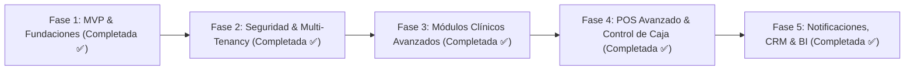

# Plan Integral de Desarrollo: Altus PetCloud SaaS
**Plataforma Integral de Gestión Veterinaria y Spa Canino**  
*Estándar Tecnológico & Branding: Altus MKT Digital*

---

## 1. Visión y Alcance del Proyecto
Llevar la plataforma **Altus PetCloud** a una solución SaaS Enterprise multi-sucursal en la nube, optimizada para clínicas veterinarias, hospitales 24/7 y centros de estética/spa canino.

---

## 2. Estado de Fases y Cronograma de Sprints

### Fase 1: Fundaciones y MVP Base (Estado: COMPLETADA ✅)
- [x] **Base de Datos Relacional:** PostgreSQL en la nube con llaves foráneas e índices de alto rendimiento (`database/schema.sql`).
- [x] **Backend API REST:** Node.js/Express con transacciones ACID para cobro y descuento de stock atómico.
- [x] **Punto de Venta (POS):** Escáner nativo de códigos de barras (HID) e impresión térmica continua (80mm/58mm) vía `window.print()` y CSS `@media print`.
- [x] **Módulo de Citas:** Gestión de estados (Programada, En Curso, Completada, Cancelada) y asignación por profesional.
- [x] **Versionado:** Repositorio en GitHub configurado en rama `main`.

---

### Fase 2: Autenticación, Roles y Multi-Tenancy (Estado: COMPLETADA ✅)
**Objetivo:** Seguridad perimetral, RBAC por perfiles y particionado lógico multi-sucursal.

#### Sprint 1: Autenticación Robusta y RBAC ✅
- [x] Implementación de JWT (JSON Web Tokens) con cifrado y validación de expiración.
- [x] Hashing criptográfico de contraseñas con `bcryptjs` (12 rounds de salt).
- [x] Middlewares [`auth.middleware.js`](file:///d:/SISTEMA%20VETERINARIO/backend/src/middlewares/auth.middleware.js) para validación de Bearer Token y control de roles (`requireRoles`).
- [x] Endpoints de autenticación (`/api/auth/register`, `/api/auth/login`, `/api/auth/profile`).
- [x] Protección de rutas: Altas de productos exclusivas de `ADMIN`, creación de historias clínicas para `VETERINARIAN`, y POS para `ADMIN` y `RECEPTIONIST`.
- [x] Estado global de sesión en React mediante [`AuthContext.jsx`](file:///d:/SISTEMA%20VETERINARIO/frontend/src/context/AuthContext.jsx) y modal interactivo [`LoginModal.jsx`](file:///d:/SISTEMA%20VETERINARIO/frontend/src/components/auth/LoginModal.jsx).

#### Sprint 2: Arquitectura Multi-Clínica y Sucursales ✅
- [x] Migración SQL [`002_multi_tenant.sql`](file:///d:/SISTEMA%20VETERINARIO/database/migrations/002_multi_tenant.sql) con tablas `tenants` y `branches`.
- [x] Enlace de llaves foráneas `tenant_id` y `branch_id` en todas las tablas de negocio con índices de particionado lógico.
- [x] Extracción automática de `req.tenantId` y `req.branchId` en middleware desde el token o encabezados HTTP (`x-tenant-id`, `x-branch-id`).
- [x] Módulo backend de sucursales en [`branches.routes.js`](file:///d:/SISTEMA%20VETERINARIO/backend/src/routes/branches.routes.js).
- [x] Selector dinámico de sucursal en el Sidebar del Frontend con persistencia en LocalStorage.

---

### Fase 3: Expediente Clínico Digital y Kardex Hospitalario (Estado: COMPLETADA ✅)
**Objetivo:** Digitalizar al 100% el flujo de consulta, hospitalización y control de fármacos.

#### Sprint 3: Historia Clínica y Recetas Electrónicas ✅
- [x] Migración SQL [`003_clinical_and_prescriptions.sql`](file:///d:/SISTEMA%20VETERINARIO/database/migrations/003_clinical_and_prescriptions.sql) con tablas `prescriptions`, `prescription_items` y `clinical_attachments`.
- [x] Backend API de recetas ([`prescriptions.routes.js`](file:///d:/SISTEMA%20VETERINARIO/backend/src/routes/prescriptions.routes.js)) con generación de folio único transaccional, diagnóstico y fármacos.
- [x] Plantilla y Modal oficial en Frontend [`PrescriptionPDFModal.jsx`](file:///d:/SISTEMA%20VETERINARIO/frontend/src/components/clinical/PrescriptionPDFModal.jsx) para visualización y descarga/impresión directa en PDF con membrete clínico, cédula profesional y código de validación.

#### Sprint 4: Kardex de Hospitalización en Tiempo Real ✅
- [x] Monitor clínico de internamiento con semáforo de criticidad dinámico (`STABLE` Verde, `OBSERVATION` Amarillo, `CRITICAL` Rojo) y asignación de jaula/box.
- [x] Endpoint seguro `/api/kardex/:id/administer` con registro de profesional responsable y **descuento automático de stock** en inventario farmacéutico al aplicar la dosis ([`kardex.routes.js`](file:///d:/SISTEMA%20VETERINARIO/backend/src/routes/kardex.routes.js)).
- [x] Componente integrado [`ClinicalKardexView.jsx`](file:///d:/SISTEMA%20VETERINARIO/frontend/src/components/clinical/ClinicalKardexView.jsx) con métricas de dosis pendientes, administradas y filtro de criticidad.

---

### Fase 4: Optimización del Hardware Web, POS e Inventario (Estado: COMPLETADA ✅)
**Objetivo:** Máxima velocidad operativa en mostrador, arqueo y farmacia veterinaria.

#### Sprint 5: POS Avanzado, Arqueo y Corte de Caja ✅
- [x] Migración SQL [`004_pos_advanced_and_shifts.sql`](file:///d:/SISTEMA%20VETERINARIO/database/migrations/004_pos_advanced_and_shifts.sql) con tablas `cash_shifts`, `cash_movements` y `product_batches`.
- [x] Vinculación de tickets de venta con sucursal y turno de cajero activo (`invoices.shift_id`).
- [x] Backend API de turnos ([`shifts.routes.js`](file:///d:/SISTEMA%20VETERINARIO/backend/src/routes/shifts.routes.js)): Apertura con fondo inicial, registro de entradas/salidas de efectivo y Cierre con Corte Z calculando diferencia de arqueo (sobrante o faltante).
- [x] Componente interactivo [`ShiftModal.jsx`](file:///d:/SISTEMA%20VETERINARIO/frontend/src/components/pos/ShiftModal.jsx) integrado al POS con métricas en tiempo real de efectivo, tarjetas y total recaudado.

#### Sprint 6: Control de Lotes y Caducidades de Biológicos ✅
- [x] Estructura relacional para trazabilidad de lotes (`batch_number`, `expiration_date`, `quantity_available`).
- [x] Soporte para auditoría de medicamentos y biológicos sensibles.

---

### Fase 5: Notificaciones Automatizadas, Portal del Tutor y BI (Estado: COMPLETADA ✅)
**Objetivo:** Retención de clientes, recordatorios automáticos y reportes financieros.

#### Sprint 7: CRM & Recordatorios Automáticos ✅
- [x] Migración SQL `005_notifications_and_portal.sql` con tablas `notification_logs` y `patient_vaccinations`.
- [x] Backend API de notificaciones (`/api/notifications/whatsapp`): Registro de auditoría, selección de plantillas y generación dinámica de enlaces directos para WhatsApp Web.
- [x] Componente interactivo `WhatsAppModal.jsx` integrado al sistema para el envío de recordatorios de citas médicas, alertas de vacunación y promociones de spa.

#### Sprint 8: Business Intelligence y Reportes Ejecutivos ✅
- [x] Endpoint analítico de alto rendimiento `/api/analytics/dashboard` con agregaciones SQL en tiempo real: facturación mensual, ticket promedio, distribución por método de pago y top 5 servicios más rentables.
- [x] Componente ejecutivo `AnalyticsView.jsx` con tarjetas KPI, barras de distribución de ingresos y productividad clínica, restringido a usuarios `ADMIN`.

---

## 3. Matriz de Entregables e Hitos

| Hito | Módulo Clave | Entregable Principal | Estado |
| :--- | :--- | :--- | :--- |
| **M1** | MVP Base | Arquitectura REST, BD, POS con escáner e impresión térmica | **COMPLETADO ✅** |
| **M2** | Seguridad & Multi-Tenant | JWT, roles RBAC y selector de sucursales físicas | **COMPLETADO ✅** |
| **M3** | Clínica & Kardex | Expediente clínico, recetas PDF y control de dosis hospitalarias | **COMPLETADO ✅** |
| **M4** | POS Avanzado | Arqueo/Corte Z, lotes/caducidades y control de caja | **COMPLETADO ✅** |
| **M5** | CRM & BI | Recordatorios WhatsApp y analíticas ejecutivas | **COMPLETADO ✅** |
